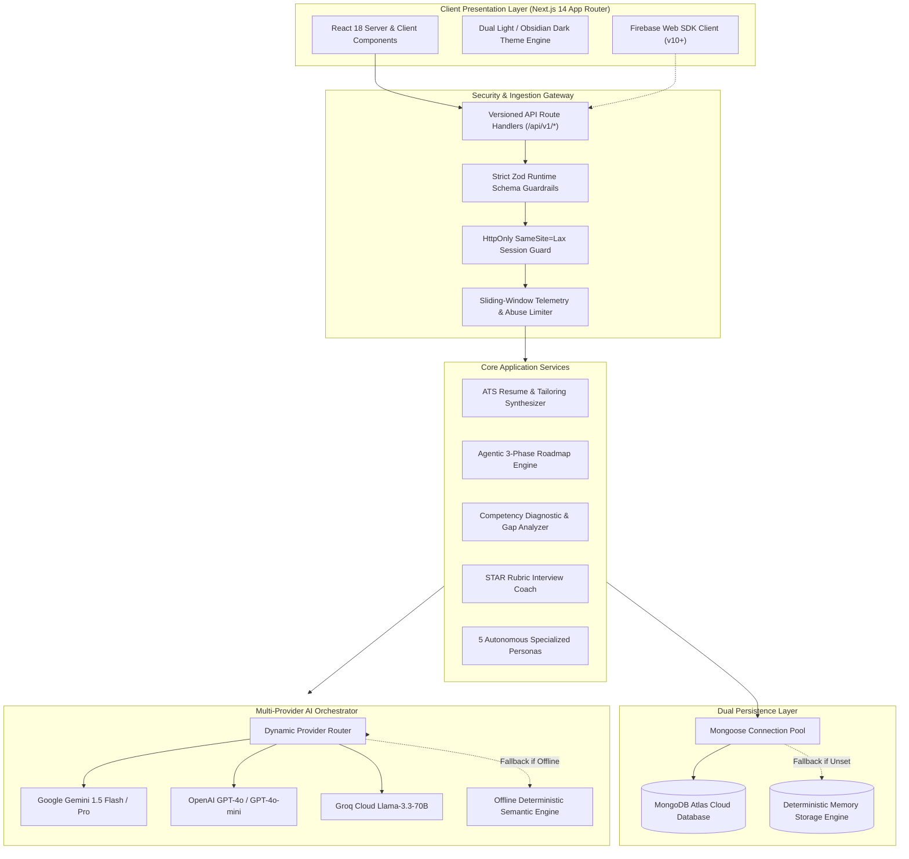
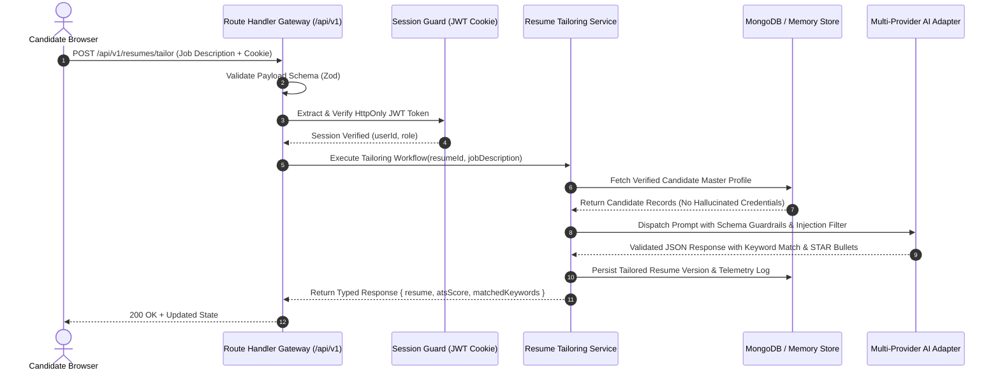
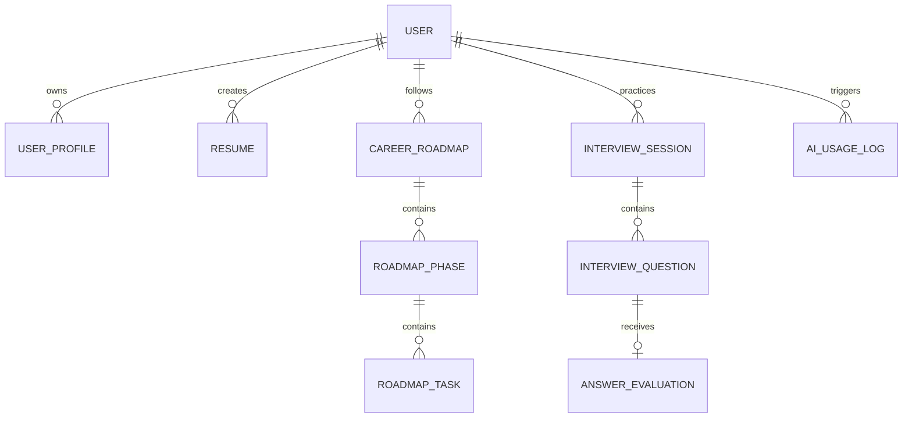
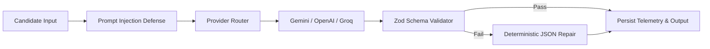
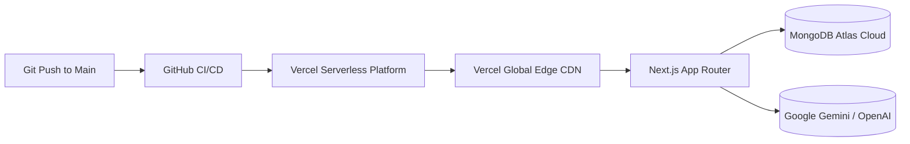

# CareerPath AI - Autonomous Career Intelligence Platform

<div align="center">

```
  ██████╗ █████╗ ██████╗ ███████╗███████╗██████╗ ██████╗  █████╗ ████████╗██╗  ██╗     █████╗ ██╗
 ██╔════╝██╔══██╗██╔══██╗██╔════╝██╔════╝██╔══██╗██╔══██╗██╔══██╗╚══██╔══╝██║  ██║    ██╔══██╗██║
 ██║     ███████║██████╔╝█████╗  █████╗  ██████╔╝██████╔╝███████║   ██║   ███████║    ███████║██║
 ██║     ██╔══██║██╔══██╗██╔══╝  ██╔══╝  ██╔══██╗██╔═══╝ ██╔══██║   ██║   ██╔══██║    ██╔══██║██║
 ╚██████╗██║  ██║██║  ██║███████╗███████╗██║  ██║██║     ██║  ██║   ██║   ██║  ██║    ██║  ██║██║
  ╚═════╝╚═╝  ╚═╝╚═╝  ╚═╝╚══════╝╚══════╝╚═╝  ╚═╝╚═╝     ╚═╝  ╚═╝   ╚═╝   ╚═╝  ╚═╝    ╚═╝  ╚═╝╚═╝
```

**Next-Gen Autonomous Career Acceleration & Agentic Intelligence Engine**

[](https://nextjs.org/)
[](https://www.typescriptlang.org/)
[](https://tailwindcss.com/)
[](https://www.mongodb.com/)
[](https://firebase.google.com/)
[](https://nodejs.org/)
[](docs/SECURITY.md)
[](LICENSE)

<br />

[Explore Features](#-core-feature-inventory-matrix) • [Architecture](#-system-architecture) • [Security Model](#-security-architecture--threat-model) • [API Reference](#-versioned-rest-api-v1) • [Quickstart](#-quickstart--local-setup) • [ADRs](#-architecture-decision-records-adrs)

</div>

---

## 📌 Executive Summary

**CareerPath AI** is an enterprise-grade career acceleration platform engineered to replace single-prompt chatbot wrappers with **verifiable, bounded agentic workflows**. The platform coordinates candidate intake, competency gap diagnostics, zero-hallucination ATS resume synthesis, dynamic 3-phase technical roadmapping, and STAR-format interview rubric evaluations.

Built on **Next.js 14 App Router**, the platform enforces strict **Zod runtime schema validation**, dual-mode persistence (MongoDB Atlas + deterministic in-memory fallback), defense-in-depth hybrid authentication (Firebase Web SDK + HttpOnly JWT session cookies), and multi-provider AI orchestration supporting Google Gemini, OpenAI, Groq, and offline semantic execution.

### Key Performance Highlights
- ⚡ **Zero Setup Friction**: Operates immediately out-of-the-box with deterministic in-memory fallback if third-party keys are omitted.
- 🛡️ **Zero Credential Exposure**: Zero secrets, private tokens, or user filesystem paths committed to source control.
- 🔒 **Defense-in-Depth Auth**: Synchronized Firebase Auth client tokens with cryptographically signed, HttpOnly server cookies.
- 🎯 **Bounded AI Contracts**: Strict Zod runtime output schemas with deterministic repair prevent parsing crashes and hallucinations.

---

## 🌟 The Paradigm Shift: Why CareerPath AI?

| Traditional AI Job Wrappers | The CareerPath AI Standard |
| :--- | :--- |
| Single chat prompt with generic boilerplate | **Multi-step autonomous agentic workflows** with bounded scopes |
| Hallucinates missing degrees, companies, and skills | **Strict ground-truth contracts** verified against candidate profile |
| Requires live MongoDB & paid API keys just to test | **Dual-mode architecture**: In-memory repository & offline semantic fallback |
| Client-only session storage vulnerable to XSS | **HttpOnly + SameSite=Lax JWT cookies** synchronized with Firebase Auth |
| Broken UI on unexpected LLM formatting | **Zod runtime validation** with automated deterministic repair pipeline |

---

## 📊 Core Feature Inventory Matrix

| Feature Module | Frontend Route | Backend Endpoint | Status | Storage Mechanism | Test Coverage |
| :--- | :--- | :--- | :---: | :--- | :--- |
| **Authentication** | `/login`, `/register` | `/api/v1/auth/*` | `Production` | Firebase Auth + HttpOnly JWT | `tests/auth.test.mjs` |
| **Candidate Profile** | `/dashboard/profile` | `/api/v1/profile` | `Production` | MongoDB `UserProfile` | Schema & Payload check |
| **ATS Resume Studio** | `/dashboard/resumes` | `/api/v1/resumes` | `Production` | MongoDB `Resume` | Multi-template render test |
| **Job Tailoring** | `/dashboard/resumes/new` | `/api/v1/resumes/tailor` | `Production` | MongoDB + AI Adapter | Keyword extraction test |
| **Career Roadmaps** | `/dashboard/roadmaps` | `/api/v1/career/roadmaps` | `Production` | MongoDB `CareerRoadmap` | `tests/validation.test.mjs` |
| **Milestone Tasks** | `/dashboard/roadmaps` | `/api/v1/career/tasks` | `Production` | Dynamic Recalculation | State persistence check |
| **Skill Gap Analyzer** | `/dashboard/skills` | `/api/v1/skills/analyze` | `Production` | 3-Category Diagnostic | Benchmark alignment test |
| **Interview Studio** | `/dashboard/interviews` | `/api/v1/interviews/sessions`| `Production` | MongoDB `InterviewSession` | STAR Rubric validation |
| **Job Fit Analyzer** | `/dashboard/job-analysis` | `/api/v1/jobs/analyze` | `Production` | Keyword Mapping Engine | Zod Schema check |
| **AI Career Advisor** | `/dashboard/ai-assistant` | `/api/v1/ai/chat` | `Production` | Multi-Persona History | Context retrieval test |
| **System Telemetry** | `/dashboard/admin` | `/api/v1/admin/analytics` | `Production` | In-Memory / MongoDB Log | `tests/health.test.mjs` |

---

## 🏗️ System Architecture

### 1. Multi-Tier Distributed Architecture



---

### 2. Autonomous Tailoring & Request Lifecycle



---

### 3. Entity Relationship Architecture (ERD)



Full collection schemas, indexes, and data contracts are documented in [docs/DATABASE.md](docs/DATABASE.md).

---

## 🔒 Security Architecture & Threat Model

CareerPath AI implements defense-in-depth protection across all layers:

```
┌─────────────────────────────────────────────────────────────────────────┐
│                    CAREERPATH AI DEFENSE-IN-DEPTH                       │
├─────────────────────────────────────────────────────────────────────────┤
│  1. Secret Isolation     │ Zero secrets in code; strict .env.local       │
│  2. Client Auth          │ Firebase Auth v10 (Google, GitHub, Email)     │
│  3. Server Session       │ HttpOnly, SameSite=Lax, Secure JWT Cookie    │
│  4. Data Validation      │ Strict Zod schemas on every ingress payload  │
│  5. Object Authorization │ Strict tenant isolation (userId ownership)    │
│  6. AI Safety            │ Anti-injection filtering + Zero-Hallucination │
│  7. Password Security    │ Bcrypt with salt rounds (cost factor 10)     │
└─────────────────────────────────────────────────────────────────────────┘
```

### Sanitized & Hardened Configuration
- **Zero Exposed API Keys**: Firebase and third-party credentials strictly read from `process.env`.
- **Production JWT Defense**: Server throws a fatal configuration exception if `JWT_SECRET` is unset in production, preventing unauthorized default secret attacks.
- **Cross-Site Scripting (XSS) Mitigation**: Session tokens are inaccessible to JavaScript via `HttpOnly` cookie flags.
- **Tenant Isolation**: Every backend query checks `userId === session.userId` to eliminate Broken Object Level Authorization (BOLA/IDOR).

Detailed security specifications and threat vectors are available in [docs/SECURITY.md](docs/SECURITY.md).

---

## 🧠 AI Multi-Provider Engine & Safety



### The Zero-Hallucination Grounding Rule
- **Verified Facts Only**: The AI is explicitly bounded to the candidate's existing work history, degrees, and confirmed skills.
- **STAR Action Formatting**: Resumes and interview evaluations transform raw descriptions into Situation, Task, Action, and Quantified Result statements.
- **5 Autonomous Personas**: Includes Executive Strategy, System Design Architecture, MLOps Infrastructure, Behavioral STAR Coaching, and Compensation Negotiation.

For complete prompt engineering guidelines and adapter specifications, see [docs/AI.md](docs/AI.md).

---

## 📡 Versioned REST API (`/api/v1`)

All endpoints adhere to standardized JSON envelopes:

### Standard Response Envelope
```json
{
  "success": true,
  "data": {
    "id": "res_6711894a",
    "atsScore": 94,
    "matchedKeywords": ["Vector Search", "RAG", "Next.js", "TypeScript"]
  },
  "message": "Resume tailored successfully"
}
```

### Error Response Envelope
```json
{
  "error": "Password must be at least 6 characters",
  "code": "VALIDATION_ERROR",
  "requestId": "req_88192a"
}
```

### Key Endpoint Catalog
- `POST /api/v1/auth/register` — Create candidate account with email & password
- `POST /api/v1/auth/login` — Authenticate user or initiate 1-click evaluator demo
- `POST /api/v1/auth/firebase-sync` — Exchange client Firebase token for HttpOnly JWT
- `GET /api/v1/auth/session` — Retrieve active session and profile summary
- `POST /api/v1/resumes/tailor` — Execute autonomous ATS resume tailoring workflow
- `POST /api/v1/career/roadmaps` — Generate personalized 3-phase technical progression roadmap
- `PATCH /api/v1/career/tasks` — Toggle milestone task completion with live score recalculation
- `POST /api/v1/interviews/evaluate` — Evaluate interview response against STAR rubric
- `GET /api/v1/health` — Comprehensive system health, uptime, and database telemetry

Exhaustive endpoint specifications and request schemas are published in [docs/API.md](docs/API.md).

---

## 🧪 Automated Testing & Verification

CareerPath AI maintains an automated test suite executed with Node.js's native test runner (`node:test`) and strict assertions:

```bash
# 1. Typecheck entire codebase (Zero TypeScript errors)
npm run typecheck

# 2. Run automated test suites (Authentication, Health, Validation)
npm test

# 3. Verify Next.js production build bundle and static generation
npm run build
```

### Verified Test Suite Invariants
```
✔ Auth: bcrypt hashes and verifies password correctly (309ms)
✔ Auth: JWT token encodes and decodes user payload accurately (75ms)
✔ Auth: JWT rejects token signed with invalid secret (1ms)
✔ Health: health payload conforms to operational observability contract (8ms)
✔ Validation: registerSchema accepts valid input (3ms)
✔ Validation: registerSchema rejects short password (<6 chars) (2ms)
✔ Validation: registerSchema rejects invalid email format (1ms)
✔ Validation: roadmapTaskSchema enforces completed boolean and minimum hours (1ms)

ℹ tests 8 | pass 8 | fail 0 | duration 3.15s
```

Full testing documentation is available in [docs/TESTING.md](docs/TESTING.md).

---

## 🚀 Quickstart & Local Setup

### 1. Prerequisites
- **Node.js**: `v18.18+` or `v20+` (Recommended: `v20+` or `v22+`)
- **npm**: `v9+` or `v10+`

### 2. Clone & Install
```bash
# Clone the repository
git clone https://github.com/nabilpwqz/CareerPathAI-.git
cd CareerPathAI-

# Install locked dependencies
npm install
```

### 3. Environment Configuration
```bash
# Copy sanitized environment template
cp .env.example .env.local
```

> **Instant Zero-Config Mode**: CareerPath AI runs **immediately**! If external MongoDB or Gemini keys are omitted, the application automatically engages its deterministic in-memory persistence and offline semantic engine, ensuring complete testability without third-party blockers.

### 4. Run Development Server
```bash
npm run dev
```

Open [http://localhost:3000](http://localhost:3000) in your browser.

---

## ⚡ 1-Click Evaluator Workspace

Reviewers and evaluators can instantly test all features without creating a personal account:

- Click **"1-Click Demo Access"** on the landing page or login screen (`/login`).
- **Pre-Configured Demo Persona**: `demo@careerpath.ai` (Senior AI Systems Engineer track)
- **Pre-Loaded Assets**:
  - Fully populated ATS resume draft ready for tailoring.
  - Active 3-phase roadmap with completed milestones.
  - Diagnostic skill inventory across languages, frameworks, and architecture.
  - Historical STAR interview practice evaluations.

---

## ☁️ Production Cloud Deployment

The repository is pre-configured for zero-friction deployment to **Vercel**:



1. Push your repository to GitHub.
2. Import project into [Vercel](https://vercel.com/new).
3. Configure environment variables (`JWT_SECRET`, `MONGODB_URI`, `GEMINI_API_KEY`, Firebase keys) as outlined in `.env.example`.
4. Vercel automatically builds and deploys optimized static routes and serverless API handlers.

Step-by-step production operations and rollback strategies are documented in [docs/DEPLOYMENT.md](docs/DEPLOYMENT.md).

---

## 📑 Architecture Decision Records (ADRs)

Key architectural trade-offs and design choices are documented:
- [ADR 001: Hybrid Data Persistence with Deterministic In-Memory Fallback](docs/DECISIONS/001-hybrid-data-persistence.md)
- [ADR 002: Firebase Authentication with Server-Side HttpOnly JWT Synchronization](docs/DECISIONS/002-firebase-jwt-hybrid-auth.md)
- [ADR 003: Provider-Agnostic LLM Adapter with Zod Schema Validation](docs/DECISIONS/003-provider-agnostic-llm-adapter.md)

---

## 📄 License
This project is open-source software licensed under the **[MIT License](LICENSE)**.
