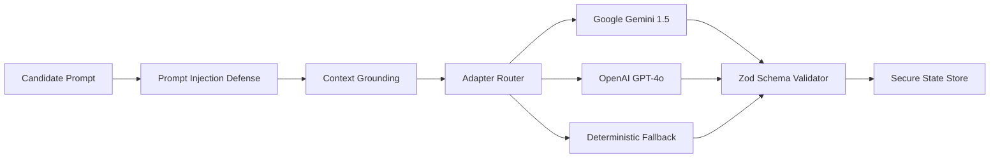

# AI Engine & Multi-Provider Architecture

## Overview
CareerPath AI integrates a provider-agnostic LLM orchestration layer capable of routing requests between Google Gemini, OpenAI, Groq, and an offline deterministic fallback engine.

## Provider Pipeline



## Anti-Hallucination Grounding Rule
1. **Verified Facts Only**: The system explicitly binds generated resumes and answers to confirmed candidate achievements.
2. **STAR Method**: Interview answers and resume bullets are structured around Situation, Task, Action, and Quantified Result metrics.
3. **Deterministic Repair**: If an LLM response contains markdown wrappers (e.g. ` ```json `), the parser cleanly extracts and validates the payload against Zod schemas.

## Personas
- **Executive Career Strategist**: Focuses on high-impact positioning, leadership metrics, and career trajectory mapping.
- **System Design Architect**: Focuses on distributed architectures, scalability trade-offs, and deep technical competencies.
- **MLOps & AI Engineer**: Emphasizes machine learning lifecycles, evaluation pipelines, and model deployment.
- **Behavioral STAR Coach**: Structures answers around behavioral leadership principles and impact delivery.
- **Compensation & Negotiation Mentor**: Advises on market rate benchmarking and offer evaluations.
